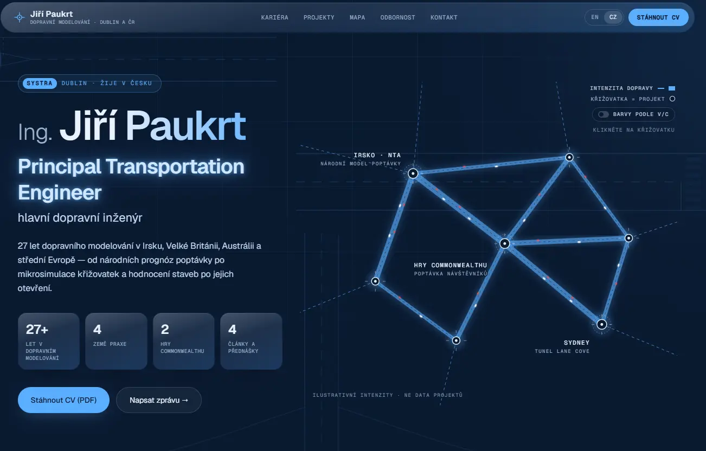
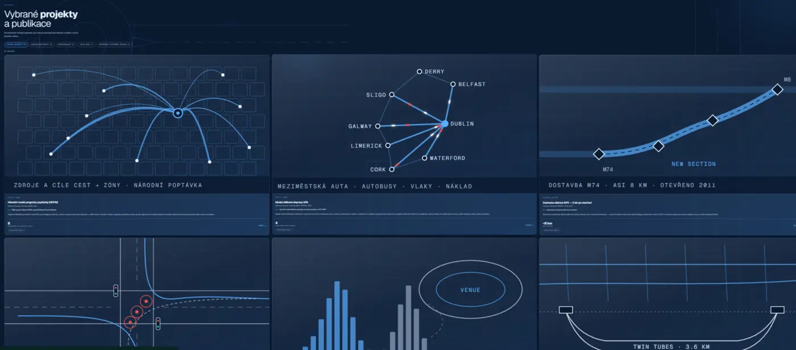
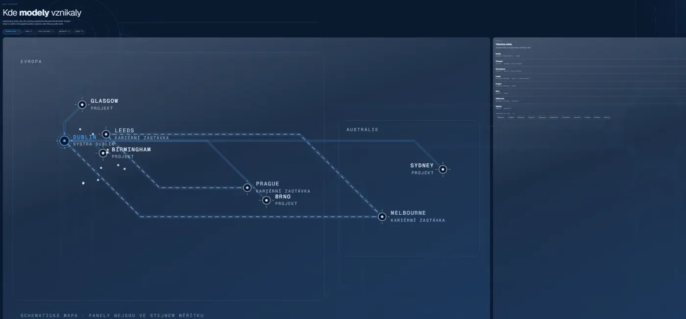
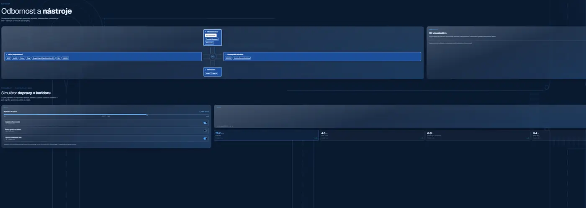

# Jiri Paukrt — osobní web (případová studie)

Živě: **https://jiri-paukrt.vercel.app** · CV v PDF: [/Jiri-Paukrt-CV.pdf](https://jiri-paukrt.vercel.app/Jiri-Paukrt-CV.pdf)

Web-vizitka a online CV pro Ing. Jiřího Paukrta, Principal Transportation Engineer v SYSTRA Dublin (27 let dopravního modelování v Irsku, Velké Británii, Austrálii a ČR).

## Jak to vypadá



| Vybrané projekty | Mapa projektů |
|---|---|
|  |  |



## Moje role

Projekt jsem vedla celý sama: **Věra Paukrtová** (portfolio: https://verapaukrtova.cz).

1. zadání a cíl webu, rozhovor s klientem a výběr faktů z jeho LinkedInu
2. směr designu a obsahová rozhodnutí (viz níže)
3. vývoj s AI asistenty (Lovable, Codex, Claude Code) podle pravidel v [`CLAUDE.md`](CLAUDE.md)
4. Git workflow s pull requesty, kontrola typů a testů před každým pushem
5. bezpečnostní kontrola (klíče, databáze, závislosti), viz [`security_warnings.md`](security_warnings.md)

## Zadání (4 otázky specifikace)

| | |
| --- | --- |
| **Co** | dvojjazyčný web-vizitka (EN výchozí, CZ přepínač) s CV ke stažení |
| **Pro koho** | personalisté a firmy z oboru dopravního inženýrství, mezinárodně |
| **Jak** | moderní tmavě modrý design s motivem silnic, křižovatek a dopravního modelu; design nesmí přebít odbornost, „Principal Engineer“ musí vyniknout |
| **Z čeho** | úvod s interaktivní sítí křižovatek, přehled práce, kariéra, projekty, mapa, odbornost (vč. malého simulátoru dopravního proudu), kontaktní formulář |

## Klíčová rozhodnutí

1. **žádný text o hledání práce.** Jirka je zaměstnaný, web ho má představit, ne inzerovat. Kontakt je formulovaný jako „zajímá vás některý z modelů nebo článků?“.
2. **pryč s vesmírem.** První verze z Lovable měla vesmírné téma („Stellar Transit Matrix“). Lidé se v ní ztráceli, a tak jsem ji předělala na téma silnic a křižovatek, které odpovídá Jirkově práci (silnice a křižovatky, ne metro).
3. **bez fotky.** Místo portrétu je monogram ve tvaru kruhového objezdu.
4. **fakta jen z LinkedInu.** Veškerý obsah je v `src/data/portfolio.ts` (EN) a `src/data/portfolio.cs.ts` (CZ). Nic není vymyšlené a ilustrativní data v grafice jsou výslovně označená.
5. **dvojjazyčnost.** Každý text má obě verze (`t("en", "cs")`).

## Technologie

TanStack Start, React 19 a TypeScript; Tailwind CSS 4 a shadcn/ui; Supabase (tabulka pro zprávy z formuláře) a Web3Forms (doručení zprávy e-mailem); hosting Lovable.

## Jak projekt vznikal

1. kostra v **Lovable**, pak propojení s GitHubem
2. další vývoj přes kód s AI asistentem (Codex, Claude Code), řízený souborem [`CLAUDE.md`](CLAUDE.md) s pravidly projektu
3. Git workflow: práce ve větvi `dev`, do `main` jen přes pull request po kontrole; `main` se synchronizuje zpět do Lovable
4. před každým pushem musí projít `npx tsc --noEmit` a `npx vitest run`

## Spuštění lokálně

```bash
bun install
bun run dev        # vývojový server
npx vitest run     # testy
npx tsc --noEmit   # kontrola typů
```

## Bezpečnost

Viz [`security_warnings.md`](security_warnings.md).

## Vyhledávání a nasazení

Anglická verze má čisté URL, česká verze používá `?lang=cs`. Obě se renderují na
serveru, mají vlastní canonical a vzájemné `hreflang`. Sitemap obsahuje obě verze.
Další parametry (např. filtr projektů) se do canonical nezapisují.

Po úspěšném nasazení na produkci spusťte `bun run indexnow`. Příkaz ověří veřejný
klíč na produkční doméně a odešle URL z nasazené sitemapy přes IndexNow.
`bun run indexnow --dry-run` ověří soubory v repozitáři bez odeslání. V Google
Search Console a Seznam Webmaster ponechte ověřovací značky a sitemapu.

### Veřejná kopie na Lovable

Preferované řešení je trvalé přesměrování 301 nebo 308 z veřejné domény
`paukrt.lovable.app` na odpovídající cesty a query na `jiri-paukrt.vercel.app`,
pokud ho Lovable umožňuje nastavit pro veřejný host. Zachovejte přístup k editoru
a iframe náhledům. Dokud běží obě nasazení, publikujte na Lovable verzi s canonical
odkazy na Vercel a ponechte ji přístupnou crawlerům, aby canonical přečetli.
Po ověření přesměrování stačí vyhledávačům předkládat sitemapu na Vercelu.
